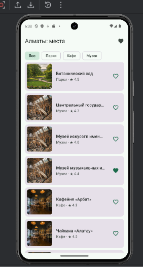
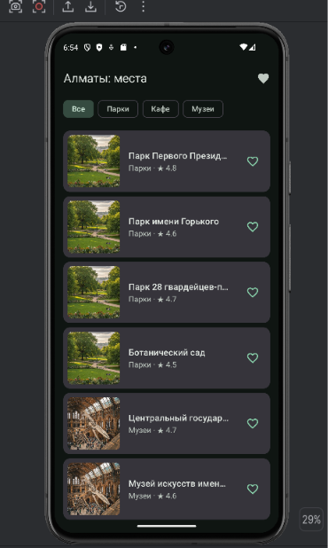
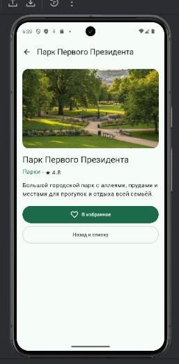
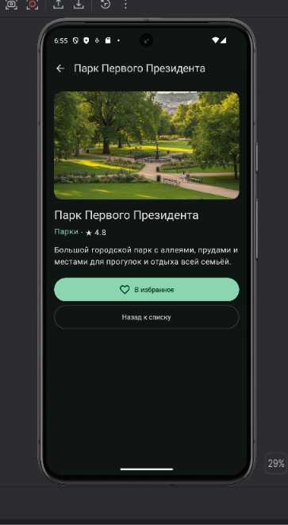
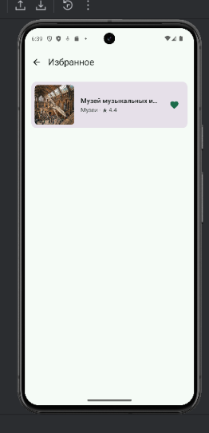
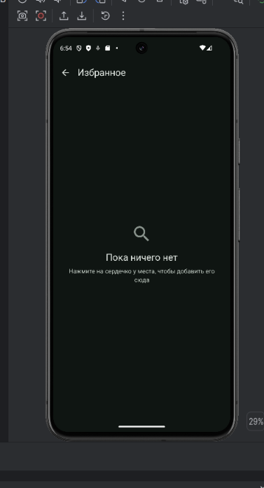
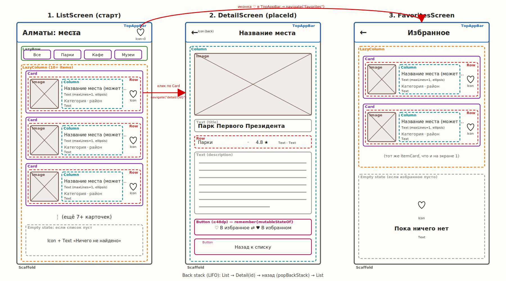
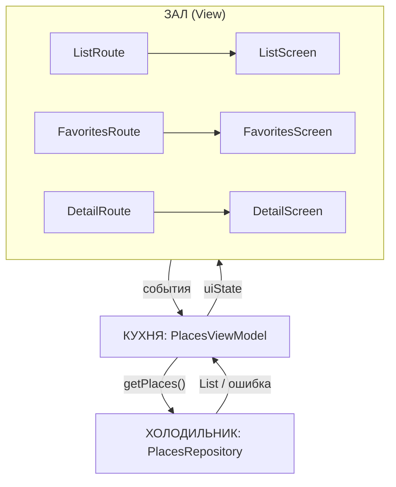

# Алматы: места

Android-приложение на Jetpack Compose: каталог интересных мест Алматы с фильтром по категориям, экраном деталей и избранным.

## Скриншоты

| Экран | Светлая тема | Тёмная тема |
|---|---|---|
| Список |  |  |
| Детали |  |  |
| Избранное |  |  |

## Эскиз и приложение

Эскиз лежит в `design/sketch.png`.



Что изменилось по сравнению с эскизом:
- Эскиз был сделан с помощью Claude и добавлен первым коммитом. Я проверил его и понял каждый блок.

## Что реализовано

- 3 экрана: список, детали, избранное (Navigation Compose, id передаётся аргументом `detail/{placeId}`)
- `LazyColumn` (10 мест) и `LazyRow` (чипы категорий)
- `Scaffold` + `TopAppBar` на каждом экране, кнопка «Назад» на втором и третьем
- Многоточие для длинных названий, пустое состояние
- Своя цветовая схема (светлая и тёмная), отступы в объекте `Spacing`
- Компоненты: `ItemCard`, `CategoryChip`, `EmptyState`, `PlaceTopBar`
- Архитектура MVVM (SIS 4): `PlacesViewModel`, `PlacesUiState`, `PlacesRepository`, stateless-экраны (см. раздел ниже)
- Поиск по названию, фильтр по категории, избранное, состояния loading / content / empty / error

## Архитектура (SIS 4)

Схема-ресторан. События идут вверх к ViewModel, состояние идёт вниз к экрану.

```
ЗАЛ (View): официанты, только показывают
  ListRoute -> ListScreen
  FavoritesRoute -> FavoritesScreen
  DetailRoute -> DetailScreen
        |   ^
 события|   | состояние (uiState)
        v   |
КУХНЯ (ViewModel): повар, переживает поворот
  PlacesViewModel
    _uiState (private MutableStateFlow)
    uiState  (public StateFlow)
        |   ^
getPlaces()|  | List<Place> или ошибка
        v   |
ХОЛОДИЛЬНИК (Repository): хранит данные
  PlacesRepository: delay(1500), shouldFail
```



Полный план (поля `PlacesUiState`, список событий) лежит в [`design/architecture.md`](design/architecture.md).

### Файлы

| Файл | Роль |
|---|---|
| `data/PlacesRepository.kt` | владеет списком мест, `getPlaces()` с `delay(1500)`, флаг `shouldFail` |
| `ui/PlacesUiState.kt` | `data class` с `val`: `isLoading`, `error`, `categories`, `selectedCategory`, `searchQuery`, `favoriteIds`, `placesById`, `visiblePlaces`, `favoritePlaces` |
| `ui/PlacesViewModel.kt` | `_uiState` / `uiState`, события, обновление через `copy()`, функция `withLists()` считает поиск и фильтр |
| `ui/screens/ListScreen.kt` | `ListRoute` (`collectAsStateWithLifecycle()`) и stateless `ListScreen` |
| `ui/screens/FavoritesScreen.kt` | `FavoritesRoute` и `FavoritesScreen` |
| `ui/screens/DetailScreen.kt` | `DetailRoute` и `DetailScreen` |
| `ui/AppNavigation.kt` | создаёт один `PlacesViewModel` и передаёт его в три Route |
| `ui/preview/PreviewData.kt` | фальшивые `PlacesUiState` для превью |

### Четыре состояния списка

Экран `ListScreen` выбирает, что показать, по полям `uiState`: `isLoading` даёт крутилку, `error != null` даёт ошибку с кнопкой «Повторить», пустой `visiblePlaces` даёт «Ничего не найдено», иначе показывается список. Для каждого состояния есть `@Preview` (Loading, Content, Empty, Error).

### Как проверить ошибку и пустой результат

- **Error:** нажми иконку «жука» в верхней панели. Репозиторий включит `shouldFail`, и после загрузки появится ошибка. Кнопка «Повторить» вызывает `onRetry()`, выключает `shouldFail` и грузит данные заново.
- **Empty:** выбери категорию «Бары» (там нет мест) или введи в поиск текст, которого нет.

### Проследим один клик: сердечко на карточке

1. Пользователь нажимает сердечко в `ItemCard` (`ItemCard.kt`), вызывается `onFavoriteClick`.
2. В `ListScreen` это лямбда `{ onFavoriteClick(place.id) }`, а в `ListRoute` она связана с `viewModel::onFavoriteClick`.
3. `PlacesViewModel.onFavoriteClick(id)` делает `_uiState.update { ... copy(favoriteIds = ...).withLists() }`: добавляет или убирает id и пересчитывает `favoritePlaces`.
4. `StateFlow` `uiState` выдаёт новое значение, `collectAsStateWithLifecycle()` в `ListRoute` передаёт его в `ListScreen`, экран перерисовывается.
5. Пользователь видит закрашенное сердечко, а на экране «Избранное» появилось это место.

## Доказательство: Activity пересоздаётся, ViewModel нет

В `MainActivity` в каждом методе жизненного цикла стоит `Log.d` (тег `LifecycleDemo`), в `PlacesViewModel` логи стоят в `init` и `onCleared`.

Logcat после поворота экрана (фильтр `tag:LifecycleDemo`):
```
---------------------------- PROCESS STARTED (6576) for package com.example.almatyplaces ----------------------------
2026-10-14 10:33:56.726  6576-6576  LifecycleDemo           com.example.almatyplaces             D  Activity onCreate (savedInstanceState = null, первый запуск)
2026-10-14 10:33:56.769  6576-6576  LifecycleDemo           com.example.almatyplaces             D  Activity onStart
2026-10-14 10:33:56.777  6576-6576  LifecycleDemo           com.example.almatyplaces             D  Activity onResume
2026-10-14 10:33:57.038  6576-6576  LifecycleDemo           com.example.almatyplaces             D  ViewModel init (создан)
2026-10-14 10:34:04.384  6576-6576  LifecycleDemo           com.example.almatyplaces             D  Activity onPause
2026-10-14 10:34:04.410  6576-6576  LifecycleDemo           com.example.almatyplaces             D  Activity onStop
2026-10-14 10:34:04.524  6576-6576  LifecycleDemo           com.example.almatyplaces             D  Activity onDestroy (isChangingConfigurations = true)
2026-10-14 10:34:04.553  6576-6576  LifecycleDemo           com.example.almatyplaces             D  Activity onCreate (savedInstanceState = не null, пересоздана)
2026-10-14 10:34:04.560  6576-6576  LifecycleDemo           com.example.almatyplaces             D  Activity onStart
2026-10-14 10:34:04.561  6576-6576  LifecycleDemo           com.example.almatyplaces             D  Activity onResume
2026-10-14 10:34:12.090  6576-6576  LifecycleDemo           com.example.almatyplaces             D  Activity onPause
2026-10-14 10:34:12.099  6576-6576  LifecycleDemo           com.example.almatyplaces             D  Activity onStop
2026-10-14 10:34:12.217  6576-6576  LifecycleDemo           com.example.almatyplaces             D  Activity onDestroy (isChangingConfigurations = true)
2026-10-14 10:34:12.251  6576-6576  LifecycleDemo           com.example.almatyplaces             D  Activity onCreate (savedInstanceState = не null, пересоздана)
2026-10-14 10:34:12.274  6576-6576  LifecycleDemo           com.example.almatyplaces             D  Activity onStart
2026-10-14 10:34:12.282  6576-6576  LifecycleDemo           com.example.almatyplaces             D  Activity onResume
2026-10-14 10:34:41.448  6576-6576  LifecycleDemo           com.example.almatyplaces             D  Activity onPause
2026-10-14 10:34:41.455  6576-6576  LifecycleDemo           com.example.almatyplaces             D  Activity onStop
2026-10-14 10:34:41.580  6576-6576  LifecycleDemo           com.example.almatyplaces             D  Activity onDestroy (isChangingConfigurations = true)
2026-10-14 10:34:41.616  6576-6576  LifecycleDemo           com.example.almatyplaces             D  Activity onCreate (savedInstanceState = не null, пересоздана)
2026-10-14 10:34:41.624  6576-6576  LifecycleDemo           com.example.almatyplaces             D  Activity onStart
2026-10-14 10:34:41.625  6576-6576  LifecycleDemo           com.example.almatyplaces             D  Activity onResume
```


Объяснение: при повороте экрана Android уничтожает Activity и создаёт новую,
поэтому после `onDestroy` снова идёт `onCreate`. Но ViewModel хранится отдельно
от Activity: система знает, что это поворот (`isChangingConfigurations = true`),
и оставляет ViewModel в памяти. Поэтому в логе нет новых `ViewModel init` и `onCleared`,
а новая Activity получает тот же `PlacesViewModel` с тем же состоянием. Именно поэтому
текст поиска, выбранная категория и избранное не пропадают.