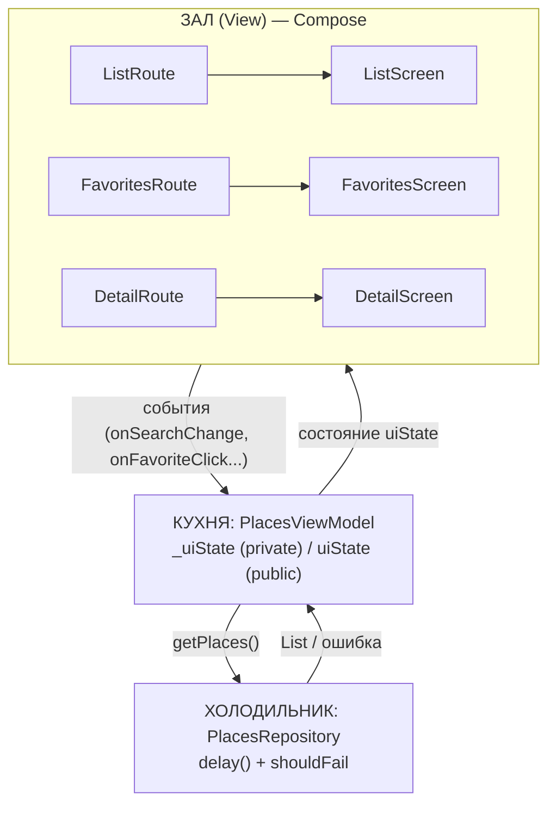

# Архитектура «Алматы: места» (SIS 4, часть A)

Схема-ресторан с моими названиями. Правило: **события идут вверх к ViewModel, состояние идёт вниз к экрану.**

```
ЗАЛ (View) — официанты: показывают, принимают заказы, ничего не готовят
  ListRoute      -> ListScreen        (список, поиск, категории)
  FavoritesRoute -> FavoritesScreen   (избранное)
  DetailRoute    -> DetailScreen      (детали места)
        |   ^
        |   |  состояние вниз: uiState (PlacesUiState)
 события|   |
 вверх  v   |
КУХНЯ (ViewModel) — повар: готовит состояние, переживает поворот экрана
  PlacesViewModel
    _uiState : MutableStateFlow<PlacesUiState>   (private, пишет только повар)
    uiState  : StateFlow<PlacesUiState>          (public, экран только читает)
        |   ^
        |   |  List<Place> или ошибка
 запрос |   |
        v   |
ХОЛОДИЛЬНИК (Model) — хранит данные, UI к списку не прикасается
  PlacesRepository
    getPlaces()  -> delay(1500), потом список мест
    shouldFail   -> если true, бросает ошибку
```



## Экраны (View)

| Экран | Файл | Что показывает |
|---|---|---|
| Список | `ListScreen.kt` (`ListRoute` + `ListScreen`) | чипы категорий, поиск, список, состояния loading / empty / error |
| Избранное | `FavoritesScreen.kt` | избранные места |
| Детали | `DetailScreen.kt` | одно место, кнопка «В избранное» |

## ViewModel

Один `PlacesViewModel` на все три экрана, потому что избранное общее для списка, деталей и избранного. Он создаётся один раз в `AppNavigation` и передаётся в три Route.

## Доска заказов — `PlacesUiState` (только `val`)

| Поле | Тип | Зачем |
|---|---|---|
| `isLoading` | `Boolean` | идёт загрузка |
| `error` | `String?` | текст ошибки, `null` если всё хорошо |
| `categories` | `List<String>` | названия чипов |
| `selectedCategory` | `String` | выбранная категория |
| `searchQuery` | `String` | текст поиска |
| `favoriteIds` | `Set<Int>` | id избранных мест |
| `placesById` | `Map<Int, Place>` | все места, нужны для экрана деталей |
| `visiblePlaces` | `List<Place>` | места после поиска и фильтра (считает ViewModel) |
| `favoritePlaces` | `List<Place>` | избранные места (считает ViewModel) |

Четыре ситуации экрана списка:
- **loading** — `isLoading == true`
- **error** — `error != null`
- **empty** — загрузка закончилась, ошибки нет, `visiblePlaces` пустой
- **content** — иначе

## События (экран -> ViewModel)

| Событие | Что делает |
|---|---|
| `onSearchChange(query)` | меняет `searchQuery`, пересчитывает `visiblePlaces` |
| `onCategorySelected(category)` | меняет `selectedCategory`, пересчитывает `visiblePlaces` |
| `onFavoriteClick(id)` | добавляет или убирает id в `favoriteIds`, пересчитывает `favoritePlaces` |
| `onRetry()` | выключает имитацию ошибки и загружает заново |
| `onSimulateErrorClick()` | включает `shouldFail` и загружает заново (чтобы показать error) |

## Репозиторий

`PlacesRepository` хранит список мест (private). Метод `getPlaces()` ждёт `delay(1500)`, как настоящий сервер. Если `shouldFail = true`, бросает ошибку.

## Проследим один клик: сердечко на карточке

1. Пользователь нажимает сердечко. Вызывается `onFavoriteClick` в `ItemCard.kt`.
2. Он пробрасывается через `ListScreen` в `ListRoute`, где подключён `viewModel::onFavoriteClick`.
3. Вызывается `PlacesViewModel.onFavoriteClick(id)`. Он делает `_uiState.update { it.copy(favoriteIds = ...) }` и пересчитывает `favoritePlaces`.
4. `StateFlow` отдаёт новое состояние, `collectAsStateWithLifecycle()` в `ListRoute` получает его, `ListScreen` перерисовывается.
5. Экран показывает закрашенное сердечко, а на экране «Избранное» появляется это место.
